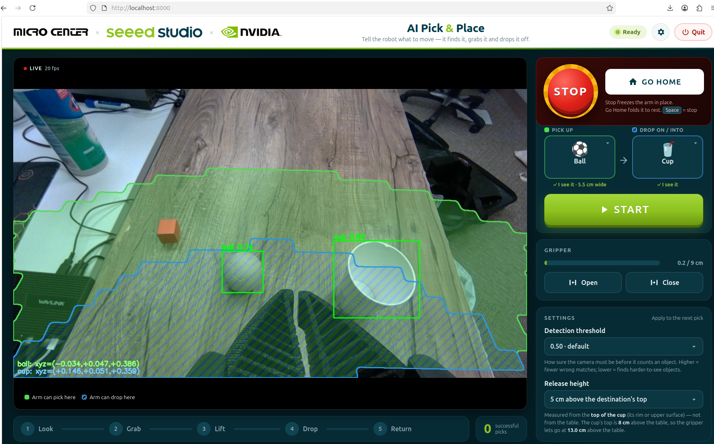
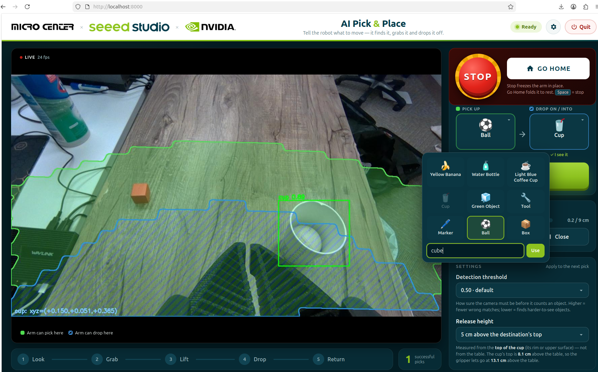
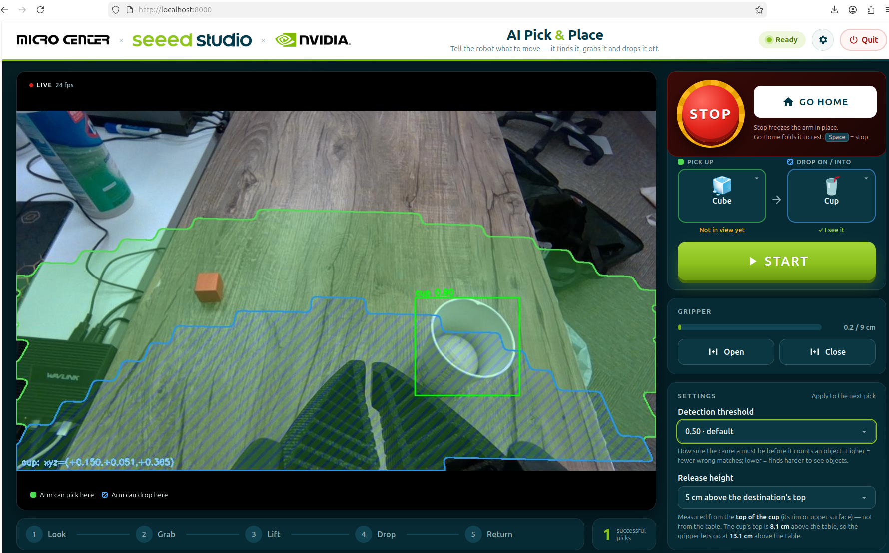

# AI Pick & Place Demo

Tell the robot arm what to move, and it does the rest: it **finds** the object with its camera, **picks it up** and **drops it off** where you asked.

You don't need to program anything. Choose an object, choose where it should go, and press **START**.

:::tip How does it know what things are?
The camera on the robot's wrist runs an AI vision model on an NVIDIA Jetson Thor. You simply type the name of an object, like "ball", "cube" or "marker", and the AI looks for it. It doesn't need to be taught each object beforehand.
:::

## The Screen at a Glance

  

| On the screen | What it's for |
| --- | --- |
| **Camera view** (left) | What the robot sees. A box appears around each object it recognises. |
| **Green area** | Where the arm can pick things up. |
| **Blue striped area** | Where the arm can drop things off. |
| **Pick up / Drop on** tiles | What to move, and where to put it. A tick ✓ **I see it** means the robot has found it. |
| **START** | Runs the whole pick-and-drop. |
| **STOP** (big red button) | Stops the arm instantly, right where it is. |
| **GO HOME** | Folds the arm back to its resting position. |
| **Gripper: Open / Close** | Opens or closes the robot's fingers by hand. |
| **Settings** | Two simple adjustments (see below). |
| **Progress bar** (bottom) | Shows what the arm is doing: Look → Grab → Lift → Drop → Return. |

## How to Use It

### 1. Choose What to Move and Where

Put an object and a cup (or a box) on the table, inside the **green area**. Check that both tiles say **✓ I see it**, then press **START**.

The arm reaches out, grabs the object, lifts it, carries it over the cup and lets go. Then it comes back, ready for the next go.

:::note Video: the robot picking up the ball and dropping it into the cup
<!-- VIDEO 1 -->
:::

### 2. Try a Different Object

Tap the **Pick up** tile. Choose one of the pictures, or type the name of any object and press **Use**.

  

If the tile says **Not in view yet**, the robot hasn't recognised the object yet, even if it's right there:

  

### 3. Help the Robot Find It

Under **Settings**, lower the **Detection threshold** a little, for example from 0.50 to 0.40. This tells the robot to be less strict about what counts as a match. Now the cube gets a box and the tile says **✓ I see it**:

  

Press **START**, and the cube goes into the cup.

:::note Video: the robot picking up the cube and dropping it into the cup
<!-- VIDEO 2 -->
:::

## The Two Settings

- **Detection threshold:** how sure the robot must be before it says "I see it". **Lower** it if the robot can't find an object. **Raise** it if it mistakes other things for the object.
- **Release height:** how far above the cup (or box) the robot lets go. It's measured from the **top of the cup**, not from the table, so the object always drops in from just above the rim. 3–8 cm works well.

:::caution
If you set the release height very high, the blue area gets smaller and can disappear completely: the arm can't reach that high. START then says **RELEASE TOO HIGH**. Just lower the release height.
:::

## If Something Goes Wrong

| You see | Try this |
| --- | --- |
| **Not in view yet** | Move the object into the green area, lower the detection threshold, or describe it differently, e.g. "orange cube" |
| **"…is out of reach"** | Move the object into the green area, or the cup into the blue area |
| **"…is too wide for the gripper"** | Pick something smaller: the fingers open up to 9 cm |
| **"Missed it"** | Press START again |

## Safety

- **STOP** (or the **Space** bar) freezes the arm immediately. Press **GO HOME** afterwards to continue.
- Keep hands out of the arm's area while it's moving.
- **Quit** (top right) asks for confirmation first, then folds the arm away, closes the gripper and shuts the demo down.

:::danger
The on-screen STOP button is a software stop. Staff should always keep the robot's power switch within reach.
:::

## Space Needed for the Demo

The arm works on objects about **30–70 cm in front of it**. It needs about **25 cm free behind it**, because its elbow folds backwards when resting, and about **60 cm (2 ft) of clear space above** it.

| Space | Will it work? |
| --- | --- |
| **Endcap** (3 ft wide × 1 ft deep × 5 ft tall) | **Only with changes.** One foot of depth is too shallow for the arm to face the aisle. It can work turned sideways, reaching along the 3 ft width, but it's a tight fit. The shelf above the arm must be removed to give it 2 ft of headroom. |
| **Inline section** (4 ft wide × 1 ft deep × 5 ft tall) | **Yes, turned sideways**, with the shelf above removed. The extra foot of width gives comfortable room for the objects and the cup. |
| **Demo area** (about 2 × 2 × 2 ft on a table) | **Yes**, if there's about 25 cm (10 in) of free space behind the arm for its folded elbow. Better still, make the area about **2 ft wide × 3 ft deep**. The 2 ft height is just enough. |

:::tip Recommended
A table area about **2 ft wide × 3 ft deep with 2 ft of clear height**, with the arm firmly clamped at the back and the screen to one side, facing visitors.
:::

## Want to Build This Yourself?

The robot arm, camera setup and software are documented on the Seeed Studio wiki:

**[reBot Arm B601-RS Visual Grasping Demo, on the Seeed Studio Wiki](https://wiki.seeedstudio.com/rebot_arm_b601_rs_grasping_demo/)**
